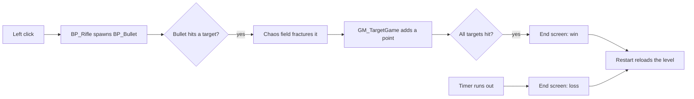

# Target Shooting Game in Unreal Engine 5

A first-person game made in Unreal Engine 5.3 with Blueprints: shoot every target in the level before the timer runs out, and each hit shatters the target with Chaos physics. Self-study project, April 2024, following Unreal Sensei's [How to Create a Game in Unreal Engine 5](https://www.youtube.com/watch?v=1XjgLKrb4_M).

This repository is a project showcase, not a maintained library.


## Demo

<a href="https://youtu.be/4WQEH5403so"></a>

[Watch the demo on YouTube](https://youtu.be/4WQEH5403so) (April 2024).

## Features

- **Targets to clear:** at the start, the game mode counts every target in the level; that count is the score to reach.
- **Rifle and bullets:** the rifle is attached to the first-person arms and fires a bullet actor with a shot animation and sound.
- **Breakable targets:** a bullet hit triggers a Chaos field that fractures the target's geometry collection, and adds a point.
- **Score and timer:** an on-screen widget shows the score against the total and the time left.
- **Win or lose screen:** clearing every target, or running out of time, ends the game with a blurred end screen and a Restart button that reloads the level.

## Installation and getting started

Prerequisites: [Unreal Engine 5.3](https://www.unrealengine.com/download) (through the Epic Games Launcher) and [Git LFS](https://git-lfs.com), because the `.uasset` and `.umap` files are stored with it.

```bash
git lfs install
git clone https://github.com/naimulnashid/unreal-target-shooting-game.git
```

Two asset packs used by the game are not in this repository, because their licenses do not allow re-sharing them:

| Folder | What it is | Where to get it |
|---|---|---|
| `Content/ScifiWeapons/` | The Ayakashi sniper rifle mesh, materials, muzzle flash and shot sound | [Sci-Fi Weapon Pack Mini](https://www.fab.com/listings/518c6caa-a643-4b50-9efe-826f99f55318) on Fab |
| `Content/Target/` | The target mesh, its fractured geometry collection and textures | [UE5 First Game Assets](https://www.unrealsensei.com/ue5firstgame) from Unreal Sensei |

Add both under those folder names, then open `FirstPersonTemplate.uproject`. Without them the project still opens, but the rifle and targets show as missing. The first open takes a while as Unreal compiles shaders.

No releases are published: running the game needs the editor and the two asset packs.

## Configuration

No configuration needed. The level is `Content/FirstPerson/Maps/FirstPersonMap`, set as the startup map.

## Usage

| Key or button | Action |
|---|---|
| W A S D | Move |
| Mouse | Look |
| Space | Jump |
| Left mouse button | Fire |
| Restart (end screen) | Play again |

## Tech stack and architecture

Unreal Engine 5.3 Blueprints (no C++), Enhanced Input, UMG widgets, and Chaos physics (geometry collections and fields), on top of Epic's First Person template.

| Blueprint | Job |
|---|---|
| `GM_TargetGame` | Game mode: counts the targets, keeps the score, runs the timer, decides win or loss |
| `BP_FirstPersonCharacter` | Template player, with the fire input added |
| `BP_Rifle` | Weapon attached to the arms; spawns bullets and plays the shot animation and sound |
| `BP_Bullet` | Projectile; on hit, spawns the Chaos field that breaks the target |
| `BP_Target` | Target with a geometry collection; on its first hit, tells the game mode to add a point |
| `WBP_UI` | Score and time display |
| `WBP_EndScreen` | End message and Restart button |



## Security and privacy

The game runs offline in the editor. It collects nothing and opens no network connections.

## Development

The project is complete and not under development. The repository was created on 2026-11-22 from the original project folder: only `Content`, `Config` and the `.uproject` are tracked, without the editor's caches (`Saved`, `Intermediate`, `DerivedDataCache`) or the two third-party asset packs. The Blueprint descriptions above were read from the saved assets; the project was not opened in Unreal for this README.

## Credits, license and support

- Built while following [How to Create a Game in Unreal Engine 5 - UE5 Beginner Tutorial](https://www.youtube.com/watch?v=1XjgLKrb4_M) by Unreal Sensei.
- Based on Epic Games' First Person template for Unreal Engine; its content is covered by the Unreal Engine EULA.
- Sniper rifle: [Sci-Fi Weapon Pack Mini](https://www.fab.com/listings/518c6caa-a643-4b50-9efe-826f99f55318) (Fab). Target: Unreal Sensei's tutorial assets. Neither is included here.
- No license is granted for this repository: it is shared to show the work, not for reuse.
- This is a personal showcase, so issues and pull requests are not monitored.
